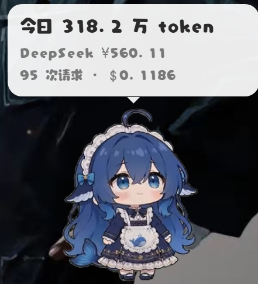

# dsh-pet-ccswitch 🐾

<p align="center">
  
</p>

把 [dsh-pet](https://github.com/PC2005-cloud/dsh-pet) 桌宠从 DeepSeek Harness 里**独立出来**，让它跟着 **[CC Switch](https://github.com/farion1231/cc-switch)** 过日子，并且**会饿、会脏、会长大、会生病**：

- **随 CC Switch 起落** —— CC Switch 一启动，桌宠自己出现；CC Switch 一退出，桌宠跟着消失
- **头顶气泡显示今日 token 用量 + 当前服务商余额**，数字全部取自 CC Switch 自己的数据库
- **养成系统**（搬自 [qqpet](https://github.com/AnkioTomas/qqpet)）：饥饿/清洁/心情/健康会随时间掉，
  成长值会长、长大了升级（宠物蛋 → 幼年期 → 成年期），病了要吃药、拖久了会死，死了要还魂丹或者安葬重养；
  打工、上学（含升学考试）、全国旅游、今日任务、签到、邮件、图鉴、粉钻、池塘养鱼都齐了
- **只吃 token 长个**：成长值全部来自 CC Switch 里新增的 token，挂机不长（`PET_RAISE_NATURAL=on` 可以改回原版那种"陪着就长大"）——
  你写代码它吃饭，不写代码它就只是饿着等着
- **工作联动**：它还是块状态牌 —— **工作区有未提交改动它就变脏，提交了就等于洗了个澡**；
  最近请求报错多它就闹情绪。配一个仓库路径（或装着项目的目录）即可
- **右键菜单**：打开 CC Switch / 查看用量与余额 / 碎碎念 / 对话 / 点播任意动画 / **一整棵养成菜单**
- **存档互通**：能把你在 [qqpet](https://github.com/AnkioTomas/qqpet) 里养着的宠物直接搬过来继续养（也能导回去）
- 档位动画按**账户余额**分档（默认 ¥0~1000 分 6 档：钱袋满溢 → 分文不剩）

> 数据**一切以 CC Switch 为准**：不在本地另建一套账，而是直接读它的 `cc-switch.db`，
> 并执行你在它界面上为每个服务商配好的 `usage_script`。你在 CC Switch 里换服务商、改配置，
> 桌宠这边自动跟着变。

---

## 安装

```sh
npx github:cloud666666666/dsh-pet-ccswitch install
```

> 包**尚未发布到 npm registry**，所以 `npx dsh-pet-ccswitch` 暂时不通；用上面的 `github:` 写法
> 效果完全一样（npm 会直接从仓库拉取）。**下文所有 `npx dsh-pet-ccswitch <命令>` 在发布前
> 都请写成 `npx github:cloud666666666/dsh-pet-ccswitch <命令>`。**

`install` 会依次做完这些事（都会跳过已完成的部分，可重复跑）：

1. 准备 `dsh-pet` 插件（首次从 npm 拉，约 65MB）
2. 给它的产物打补丁（把气泡改成用量视图、菜单指向 CC Switch）
3. 准备 Electron（首次约 100MB；已有则跳过）
4. 把代码同步到 `%LOCALAPPDATA%\dsh-pet\app`（这样 `npx` 的临时目录删掉也不影响）
5. 注册开机自启，并立刻启动

**要求**：Windows + Node.js ≥ 22.5 + 已经装好并运行过 CC Switch。

## 命令

| 命令 | 作用 |
| --- | --- |
| `npx dsh-pet-ccswitch install` | 准备环境 + 注册自启 + 启动 |
| `npx dsh-pet-ccswitch start` / `stop` / `restart` | 启停宿主（宿主会带着桌宠一起）；`stop` 连**孤儿桌宠窗口**一起收 —— 宿主被强杀或手动起过实例时，桌面上可能留下不认宿主的第二只 |
| `npx dsh-pet-ccswitch status` | 看宿主/CC Switch 状态、**桌宠窗口数**（多于 1 会明确报警）、今日用量、余额、宠物状态 |
| `npx dsh-pet-ccswitch raise` | 看宠物养成状态（`raise <动作串>` 可直接在命令行上喂它；`raise config/import/export` 见下） |
| `npx dsh-pet-ccswitch doctor` | 自检：CC Switch 在哪、库能不能读、缺什么 |
| `npx dsh-pet-ccswitch patch` | 升级 dsh-pet 后重新打补丁 |
| `npx dsh-pet-ccswitch uninstall [--purge]` | 移除自启（`--purge` 连运行数据一起删，配置会先备份） |

`raise` 后面可以跟菜单叶子上的那一串「动作串」，效果跟点右键菜单一样：

```sh
npx dsh-pet-ccswitch raise status          # 让它报一遍状态（也会弹气泡）
npx dsh-pet-ccswitch raise use:food:102010001   # 喂一个圈圈冰激凌
npx dsh-pet-ccswitch raise doctor          # 看病（诊费+开药）
npx dsh-pet-ccswitch raise trip            # 出门旅游
npx dsh-pet-ccswitch raise link:state      # 让它把各仓库的未提交数量念一遍
npx dsh-pet-ccswitch raise config          # 看/改养成配置（日历、天气、工作联动、汇率）
npx dsh-pet-ccswitch raise import <存档>   # 把 qqpet 养的宠物搬过来
npx dsh-pet-ccswitch raise --menu          # 把当前菜单树打出来（里面有所有动作串）
```

## 养成

桌宠不只是挂件了。养成这套玩法**整套搬自 [qqpet](https://github.com/AnkioTomas/qqpet)**
（QQ 宠物复刻项目），逻辑、数值、台词都是照它的源码来的，表现层改成了「气泡 + 右键菜单」
（桌宠没有 qqpet 那些 SWF 界面，原版的弹窗/面板/小游戏窗口在这里落不了地）。

**在养什么**

| | 说明 |
| --- | --- |
| 属性 | 饥饿 / 清洁 / 心情 / 健康（0~5），随时间掉；下限是 0，上限随等级涨（1000 + 等级×100） |
| 成长 | **只从 token 来**：这段时间 CC Switch 日志里新增的 token × 汇率 × 换算系数；成长值决定等级，5 级进幼年、16 级成年 |
| 生病 | 状态差 → 疲劳 → 随机生病（咳嗽/感冒/肚子胀三条病线，各四档）→ 健康掉到 0 就死了 |
| 死亡 / 复活 | 死亡后可以用还魂丹救回来（诊费按原版算），也可以安葬它、重新选蛋领养（可选性别） |
| 物品 | 990 件物品表原样搬过来（食物 560 / 日用品 288 / 药品 22 / 玩具 27 / 功能 5 等），属性、价格、等级门槛、粉钻限制都在 |
| 商店 | 右键菜单里按类型分好，推荐款在前、便宜款垫后；粉钻八折 |
| 打工 | 24 份工作，各有等级/属性/学历门槛与元宝收益，干完活给钱给属性 |
| 上学 | 9 个科目，各有课时；课时修满就要**升学考试**（3 题全对才过，题库照搬），考过学籍 +1、换学校 |
| 旅游 | 35 个去处，随机去一个、约 1 小时回来；带回奇遇文案、纪念品（新省份掉更好的池）与明信片（进相册、寄到邮箱） |
| 任务 | 今日任务（按宠物当前需求加权抽 4 条，节假日多一条）+ 逗逗我 / 学习打工 / 旅游任务三张固定表 |
| 签到 | 每天签到给一件抽奖物品；抽成长值（三位数老虎机）；在线每 20 分钟一次奖励（第二次起 100 元宝） |
| 日历 | 节假日（含调休）、节气：放假日判定、节日问候、节假日邮件都看它。**要联网，一条命令开**，见下 |
| 天气 | 恶劣天气提醒 + 每天的天气播报（雷暴/大雪/大风/高温/降温）。**要联网，一条命令开** |
| 邮件 | 欢迎信、生日信、节假日信、旅游明信片；附件点一下就进背包 |
| 贵族 | 粉钻（首开 666 元宝/5 天，之后等级×888）：成长 +10/小时、买东西八折、签到多抽一次、池塘加速；贴心宝贝（300 元宝/天）：宠物会自己照顾自己，成长 +10% |
| 池塘养鱼 | 16 种鱼苗（等级门槛 0~45），2~3 小时长一档，10 元宝喂一小时，熟了按售价收，收满 1000 条「养鱼大师」 |
| 工作联动 | 把工作区状态接进属性：**工作区脏 = 它脏**（每 5 分钟最多掉 20 点清洁），**提交 = 洗澡**（清洁 +15、心情 +5），**请求报错多 = 心情差**（错误率越高掉得越多）。见下 |
| 存档互通 | `raise import` / `raise export`：与 qqpet 的存档格式一致，来回搬不丢东西 |

**token 怎么变成成长值与元宝**

每分钟结一次账：这分钟里 CC Switch 的日志新增了多少 token，就按汇率折算
（默认 **100 万 token = 300 成长值 + 100 元宝**）。所以「今天写了多少代码」直接等于「宠物吃了多少饭」。

成长值那一头还要乘一个**换算系数**（元宝不乘，给多少是固定的）：

| 系数来源 | 效果 |
| --- | --- |
| 心情 | 开心 ×1 / 平静 ×0.9 / 郁闷 ×0.7 / 难过 ×0.5 —— 心情不好，token 也长得慢（这正是心情这个属性现在的主要作用） |
| 粉钻 | ×1.125（原版是"成长 +10/小时"，基准 80/小时，这里按同一基准折成比例） |
| 限时物品 | 同理，按它标称的「成长值/小时」折算 |
| 贴心宝贝 | ×1.1（原版就是这个乘数） |

桌宠的状态气泡与 `npx dsh-pet-ccswitch raise` 都会在系数不等于 1 时标出来（`成长 18419 / 21775 ×0.90`），
它自己报账时也会说一句「心情不太好，长得慢一点」，免得对不上账。

想回到 qqpet 那种"几个月才成年"的慢节奏，把汇率调小即可（`PET_RAISE_GROWTH_PER_MTOK`）；
想让挂机也能长个（原版行为），设 `PET_RAISE_NATURAL=on`。

**计时口径**

- 桌宠在的时候才算账（CC Switch 退出 → 桌宠退出 → 养成暂停），关掉的那段时间不补算属性 ——
  与 qqpet「关掉应用不算在线时长」一致，所以出差一周回来宠物不会饿死
- 但**打工/上课/旅游的进度会接着算**（这是 qqpet 自己的设计：活儿在那边继续干着）
- 单次补算最多 6 小时（合盖睡一夜再打开，不会一口气掉光）
- 06:00 换日：今日任务重抽、签到与在线奖励重置、鱼塘加速到账、该发的邮件发出来

**数值怎么看**

物品加的是**固定值**（饥饿+100、清洁+720…），所以：

- 状态里每一栏给的都是**「当前 / 上限」**（`饥饿 █████░░░ 2270/3500`），不是百分比 ——
  百分比交给进度条表达，数值才是拿来算账的
- **用完物品会把变化量回显出来**：`清洁 3497→3500　心情 782→802`。
  标称 +200 的清洁剂只补上 3（已经满了）这件事一眼就看得出来，不会白喂
- 菜单里的物品标签写的是它标称的效果（`🛁舒爽喷湿器 ×2（清洁+200）`），两下一对就知道该喂哪个

**没搬过来的三块**（不是偷懒，是搬不了）

| 没搬的 | 为什么 |
| --- | --- |
| 98 个小游戏 + 密室探险 | qqpet 那边是 Ruffle 播 SWF 的**实时交互窗口**（还带虚拟手柄），桌宠这边没有窗口也没有 SWF 素材。要接只能另写一套小游戏，那就不叫"搬 qqpet 的"了 |
| QQ 农场 | qqpet 只是把一个 SWF 的存档搬来搬去，**种植/虫害/收成规则全在 Farm.swf 内部**，没有 SWF 就无从照搬 |
| 原版美术 | 宠物形象、物品图标、全景图都是腾讯的美术资源；桌宠这边用 dsh-pet 自己的动画池顶替（吃饭用「吃什么」那 12 段、洗澡用玩水枪/吐泡泡、生病蔫一点的那几段） |

这三块直接影响的就是「今日任务」里原版那两条小游戏任务 —— 它们没有进池子，
免得生成做不完的任务；农场相关的提醒也去掉了。

**存档**

养成存档在 `%LOCALAPPDATA%\dsh-pet\user\raise.json`，字段名与 qqpet 一致
（连它把 computed 拼错的 `petComputedlInfo` 都保留），坏字段会按原版的兜底值自动修复。
想重新养一只：删掉这个文件，或者右键菜单「重新领养一只」。

## 为什么能扛住 CC Switch 升级

这是设计目标之一，具体做法：

- **不写死安装路径**。找 `cc-switch.exe` 的顺序是：正在运行的进程 → 上次发现的路径 → 注册表卸载项 → 常见路径 → 开始菜单快捷方式。它换目录、换盘符都能自己跟上。
- **只依赖两样东西**：进程名（判活在不在）和它的数据库。前者按 `cc-switch*` 前缀匹配，后者用标准的 SQLite 读，且查询前后都有容错 —— 读不动会在 `doctor` 里明确告诉你，而不是崩掉。
- **余额查询不自己发明规则**：直接执行 CC Switch 为每个服务商配的 `usage_script`（`{request, extractor}`），它怎么查我们就怎么查。它加服务商、改解析逻辑，这边自动生效。
- **桌宠那边也一样**：所有改动都是**幂等补丁**，认不出原文时会告警并退化成原版行为，不会把桌宠搞坏。跑 `patch` 可随时重打。

## 工作原理

```
CC Switch  ←── 读 cc-switch.db（用量/服务商/usage_script）──┐
     ▲                                                      │
     │ 进程在不在                                          ▼
     └──────────── 宿主 host.mjs ──── HTTP :3080 ──── 桌宠（Electron 透明小窗）
                        │                                   ▲
                        └── 养成系统 lib/raise/ ────────────┘
                             · 每分钟结算，token 折算成成长值/元宝
                             · 菜单树每秒下发（内容随宠物状态/背包变）
                             · 桌宠点菜单 → POST 回宿主 → 结果经气泡弹回来
```

- CC Switch 是**数据源**，也是**生命周期信号源**（宿主每 2 秒看一次它的进程）
- 桌宠本体是原版 `dsh-pet`（只打了补丁），跑在自带的 Electron 上
- 宿主的 HTTP 接口是照着 dsh-pet 原本的契约实现的，所以桌宠换新版本也大概率能直接用
- **养成系统整个跑在宿主里**（`lib/raise/`，普通 Node 代码，可单测）：桌宠那边只多了六处薄补丁 ——
  菜单段由宿主下发、点菜单 POST 回宿主、点宠物算"逗它"、广播通道多带一个动画名与菜单、说话动画可以被指定、
  多行气泡逐行渲染。所以加玩法不用再动 dsh-pet 的产物

## 配置

运行数据在 `%LOCALAPPDATA%\dsh-pet\`：

| 文件 | 说明 |
| --- | --- |
| `user/main-config.json` | 桌宠配置：大小 / 位置 / 显示方式 / 碎碎念开关 |
| `user/raise.json` | **养成存档**：属性、成长、背包、任务、邮件、鱼塘（删掉即重新养一只） |
| `user/memory.json` | 对话记忆（删掉即清空） |
| `runtime.json` | 记住发现到的 `cc-switch.exe` 路径等 |
| `logs/host.log` | 宿主日志 |

环境变量：

| 变量 | 默认 | 说明 |
| --- | --- | --- |
| `DSH_PET_HOME` | `%LOCALAPPDATA%\dsh-pet` | 运行数据目录 |
| `PET_HOST_PORT` | `3080` | 宿主端口 |
| `PET_TIER_MAX` | `1000` | 档位刻度：余额到这个数 = 第 0 档「钱袋满溢」 |
| `PET_FOLLOW` | `1` | 设为 `0` 关闭「跟随 CC Switch」 |
| `PET_FOLLOW_INTERVAL` | `2000` | 跟随检查间隔（ms） |
| `PET_LLM_PROXY` | `http://127.0.0.1:15721` | 碎碎念/对话用的通道（CC Switch 的本地代理） |
| `PET_LLM_MODEL` | `claude-haiku-4-5` | 同上 |
| `CCS_DB` | `~/.cc-switch/cc-switch.db` | CC Switch 数据库路径 |
| `PET_CC_PROCESS` | 自动 | 覆盖「CC Switch 进程」的匹配条件（排障用） |
| `PET_RAISE_GROWTH_PER_MTOK` | `300` | **每 100 万 token 换多少成长值**（想让宠物长得慢就调小） |
| `PET_RAISE_YB_PER_MTOK` | `100` | **每 100 万 token 换多少元宝** |
| `PET_RAISE_NATURAL` | `off` | 设 `on` 恢复原版的"挂机也长个"（80/小时 × 心情系数）；默认只吃 token |
| `PET_RAISE_AMBIENT_GAP` | `600` | 它主动说话的最小间隔（秒）：饿了、鱼熟了这类提醒不会刷屏 |
| `PET_RAISE_CALENDAR` | `off` | `holiday-cn`（推荐）或 `ankio` 才联网取节假日，见下 |
| `PET_RAISE_WEATHER` | `off` | 设 `on` 才联网播报天气（走 wttr.in） |
| `PET_RAISE_WEATHER_CITY` | 空 | 天气播报的城市，空 = 按 IP 定位 |
| `PET_RAISE_LINK_REPO` | 空 | 工作联动盯的仓库路径（或装着项目的目录）；空 = 不启用 |
| `PET_RAISE_LINK_GIT` | `on` | 工作区脏 → 它变脏（提交 = 洗澡） |
| `PET_RAISE_LINK_ERRORS` | `on` | 请求错误率影响心情 |
| `PET_RAISE_LINK_EVERY` | `300` | 工作联动的采样间隔（秒） |

上面这些也可以写进**配置文件** `%LOCALAPPDATA%\dsh-pet\user\raise-config.json`，
优先级是 **配置文件 > 环境变量 > 默认值**。日常改配置不用碰环境变量：

```sh
npx dsh-pet-ccswitch raise config                                # 看当前生效值（标出每个值来自哪一级）
npx dsh-pet-ccswitch raise config calendar=holiday-cn weather=on  # 改（写进配置文件）
npx dsh-pet-ccswitch raise config linkRepo=D:\Project             # 工作联动：接上工作区（也可以给装着项目的目录）
npx dsh-pet-ccswitch restart                                     # 重启生效
```

## 工作联动（把工作区接进宠物）

给它一个仓库路径（或者一个装着好几个项目的目录，它会扫一层子目录），它就会盯着那里的状态：

| 外部信号 | 宠物这边 | 数值 |
| --- | --- | --- |
| 工作区有未提交改动 | **变脏**（改动越多越快），并唠叨一句「工作区还有改动没提交…」 | 每 5 分钟最多掉 20 点清洁 |
| 提交了（HEAD 变了） | **洗了个澡**，一身轻松 | 清洁 +15、心情 +5 |
| 工作区全干净 | 慢慢回一点（抵掉一半的自然变脏速度） | 每 5 分钟 +10 |
| 最近 60 分钟的请求有 4xx/5xx | **闹情绪**，错误率越高掉得越多 | 心情 −（错误率 × 60，最多 −20） |
| 最近请求全成功 | 心情回一点 | +3 |

所以「清洁」这个属性现在是双份含义：**时间会让它脏，代码不提交也会让它脏；洗澡（喂清洁用品）与提交都能让它干净**。
右键菜单里「🧹 工作区状态（提交 = 洗澡）」点一下，它会把你各个仓库的未提交数量念一遍；状态气泡上也会多一行。

采样间隔、开关都在配置里：`linkRepo` / `linkGit` / `linkErrors` / `linkEverySec`（默认 5 分钟）。
不需要的话把 `linkGit` 或 `linkErrors` 设成 `off` 即可（`linkRepo` 留空就整块不启用）。

## 存档互通（与 qqpet 互相搬）

```sh
npx dsh-pet-ccswitch raise import "%APPDATA%\QQPet\save.json"   # 把 qqpet 养的宠物搬过来
npx dsh-pet-ccswitch raise export 我的宠物.json                  # 导出一份能丢回 qqpet 的存档
```

- 认两种来源：qqpet 的 `save.json`，以及原版 QQ 宠物的 `config.json`（宠物数据在 `petInfoData` 底下）
- 导入是**全量替换**：现有的 `raise.json` 会先备份成 `raise.json.bak`（想换回来拷回去就行）
- 导入时会丢掉这边没有的界面设置、清掉"导入时正在进行的打工/上课/旅游"（免得一启动就按"关掉很久"瞬间算完）、
  重置记账水位（不会把导入前已经发生的 token 一次性算成收益）
- 导出的是干净的 qqpet 存档（把这边特有的两个水位字段摘掉），丢进它的 userData 就能接着养
- 宿主跑着的时候导入会先把它停掉再启动（否则内存里那份状态会在下次落盘时盖回去）

## 日历与天气（可选，要联网）

这两样都**默认关着**（要联网，且等于把日期/城市发给第三方），一条命令就能开：

```sh
npx dsh-pet-ccswitch raise config calendar=holiday-cn weather=on
```

| | 数据源 | 说明 |
| --- | --- | --- |
| 节假日（含调休） | [NateScarlet/holiday-cn](https://github.com/NateScarlet/holiday-cn)（走 jsDelivr） | 只下载「当年放假安排」这一个公开 JSON，不带你的任何信息。有了它，放假日判定才准 —— 比如调休上班的周六不会被当成放假 |
| 节气 | **本机算**（太阳视黄经每 15°，Meeus 公式 + 二分，误差 < 1 分钟） | 不联网，2026 年 24 个节气和公开历法逐条对得上 |
| 农历 | 只有 `ankio` 那档有 | 就是「今天是农历八月十八」这种闲聊 |
| 天气 | [wttr.in](https://wttr.in) | 恶劣天气必定提醒（雷暴/大雪/大风/高温/降温），好天气有一半概率在启动时报一次；每天最多说一句 |
| 城市 | `weatherCity`，空 = 按 IP 定位 | |

> `PET_RAISE_CALENDAR=ankio` 是 qqpet 原本用的接口（`api.ankio.net`），能多给农历，
> 但**实测国内直连超时**（timor.tech 同样连不上），所以推荐用 `holiday-cn`。

## 碎碎念 / 对话

走 CC Switch 的本地代理调模型，**只在你点右键菜单时才会调用**，单次约 100~200 token。
不点就不会有额外消耗。养成那边的台词全是搬过来的固定文案，**一个 token 都不花**。

## 已知限制

- **仅 Windows**（进程发现、自启、窗口置前都用了 Windows 专有手段）
- 界面上显示的是「CC Switch 当前在用」那一个服务商的余额（取最近一条请求实际走到的服务商）。
  计价单位默认按人民币余额校准（`PET_TIER_MAX`），换成美元计价的服务商时这个刻度含义会变
- 余额查不到时不会伪造数字，会显示失败原因 —— 这是原版就有的设计
- **养成只有气泡和右键菜单**：原版 qqpet 的属性面板、背包页、考试窗口、小游戏窗口在这边都没有，
  所以状态是一段多行气泡、操作是菜单项。升学考试因此做成「点菜单答题」（一题一个菜单项，得点开三次菜单）
- **98 个小游戏、密室探险、QQ 农场没搬**（原因见上面「没搬过来的三块」），
  今日任务里原版那两条小游戏任务也相应去掉了
- 节假日与天气**默认关闭**（要联网，见上面「日历与天气」一节，一条命令可开）。
  关着的时候跟 qqpet 离线时一样按周末算放假 —— 调休上班的周末会算错，开 `calendar=holiday-cn` 才准
- 成年后（16 级）宠物形象不变：dsh-pet 的动画是按动画名播的，没有"按阶段换形象"这一层，
  qqpet 那边是 SWF 里 Egg/Kid/Adult 三套素材

## 致谢

- 桌宠本体是 [dsh-pet](https://github.com/PC2005-cloud/dsh-pet)（MIT），本包只做适配与宿主。
- **养成玩法搬自 [qqpet](https://github.com/AnkioTomas/qqpet)**（QQ 宠物跨平台复刻，GPL-3.0）：
  等级公式、属性衰减、疲劳与生病、物品表（990 件）、工作/课程/旅游点、任务与台词、
  疾病与死亡台词、鱼苗表等等都是照它的源码搬过来的，用
  `node scripts/import-qqpet-data.mjs <qqpet 仓库路径>` 可以重新导出这些数据表。
  它的美术资源（QQ 原版形象、SWF、旅行照片）没有搬，版权归腾讯与《旅行青蛙·中国之旅》所有。
- ⚠️ 许可提醒：qqpet 是 **GPL-3.0**，本项目是 MIT。两边都是同一台机器上的个人项目时问题不大，
  但**如果你要发布/分发这个包，先确认你有权把 GPL 代码与那份数据表放进 MIT 项目里**，
  或者把这里对应的部分也按 GPL-3.0 发布。
